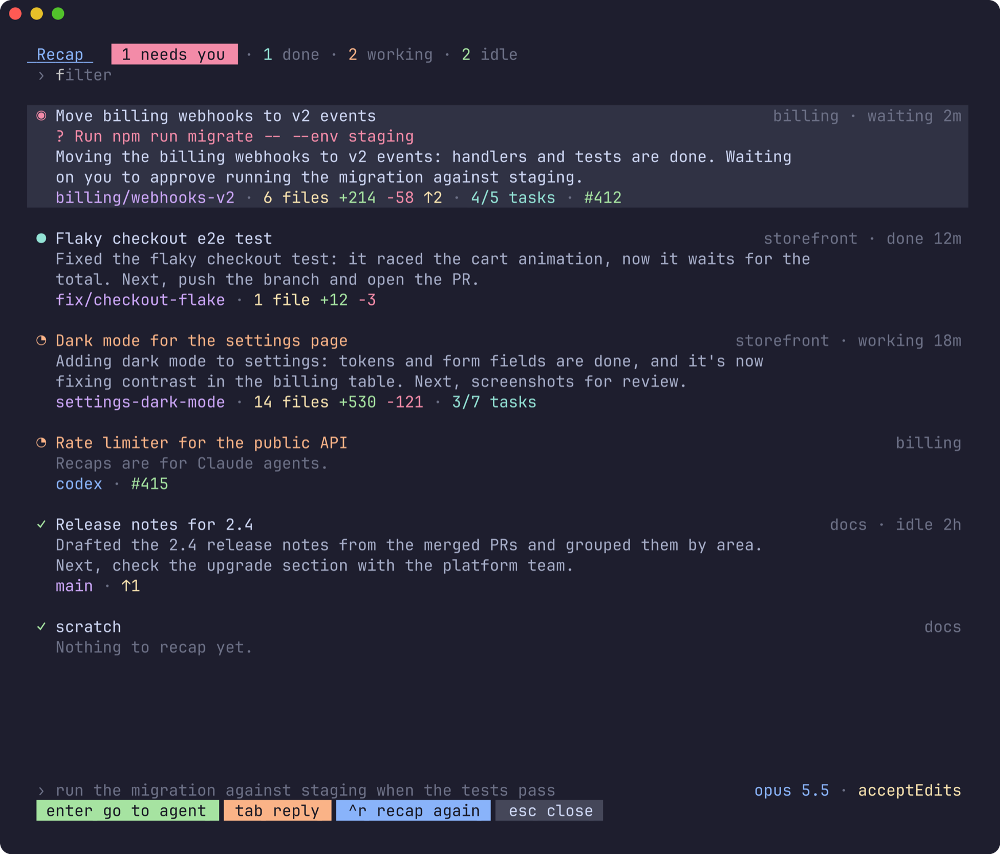
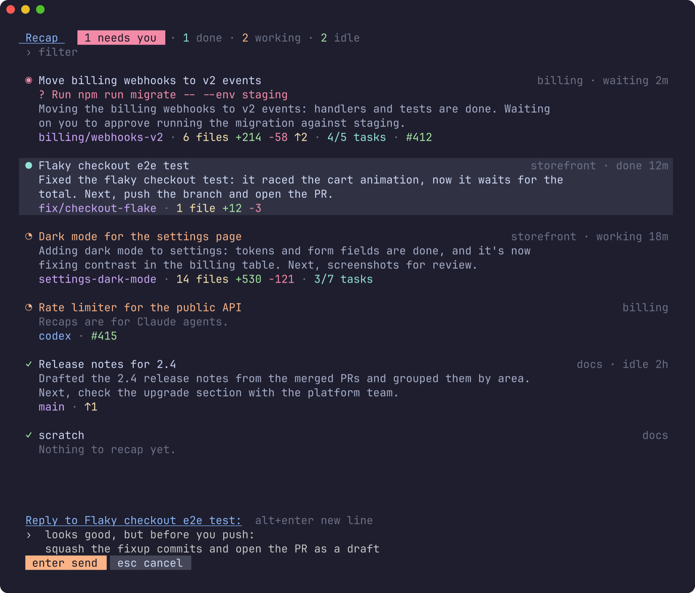

# herdr-recap

**Come back to a bunch of agents and know in seconds which ones need you.**

Starting a new agent is almost too easy. Coming back to a dozen or more and
remembering what each one was doing is the pain. herdr-recap is a
[herdr](https://herdr.dev) popup that tells you, per agent, where it got to
and whose move it is.



- **Recaps are written while you're away.** Claude Code's own `/recap`, or
  the agent's equivalent, run in a throwaway fork, so your agent's
  conversation doesn't get touched.
- **Only when it's worth it.** A recap is written once an agent has sat
  finished or blocked for a few minutes without you looking, while its
  prompt cache is still warm.
- **Grouped by whose move it is.** Needs you, Done, Needs fixing, Idle,
  Working, In review and Merged, shown as tabs with counts; then Snoozed,
  with herdr-snooze.
- **See what a blocked agent wants.** The pending question or command is
  right on the row.
- **Reply without leaving the popup.** Tab, type, enter; or enter or click
  to jump straight to the agent.
- **Full context at a glance.** Each row has the branch, uncommitted and
  unpushed work, task progress, PR state, and how long it has been waiting.
- **Type to filter** across titles, recaps, branches, stages and workspaces.
- **Search built in.** When no row matches, the agents' conversations are
  searched for what you typed, so you find the agent that said it. Uses
  Memex to put the best match first, if it's installed.
- **Want better titles?** Agents with no title, or a slug for one, get a
  suggested name with their ticket key, applied with one keypress.
- **Pull requests and Linear issues are links**, with herdr-github and
  herdr-linear installed.
- **How the machine's doing**, beside the tabs: its CPU and memory, with
  herdr-vitals installed.
- **It fits in.** Follows herdr's theme, works with the mouse.
- **Works with Claude, Codex, OpenCode and Hermes** (the last two through
  Memex). Linux and macOS.

## Works with the other herdr plugins

This is one of six plugins that are useful alone and better together.
Install [herdr-github](https://github.com/mrolafsson/herdr-github), [herdr-linear](https://github.com/mrolafsson/herdr-linear), [herdr-snooze](https://github.com/mrolafsson/herdr-snooze), [herdr-vitals](https://github.com/mrolafsson/herdr-vitals) or [herdr-file-transfer](https://github.com/mrolafsson/herdr-file-transfer) alongside it and they find each other:
there is nothing to configure.

| Plugin | What it adds to the others |
| --- | --- |
| **[herdr-recap](https://github.com/mrolafsson/herdr-recap)** (this one) | Every agent in one list. An agent's pull request and its Linear issue are links there: a click, or `ctrl+g` / `ctrl+l`, opens it in the plugin it belongs to. Snoozed agents have a tab of their own: `ctrl+s` snoozes an agent, in Snooze's popup, and `ctrl+w` wakes one. |
| [herdr-github](https://github.com/mrolafsson/herdr-github) | Tags every space and agent with its branch's pull request (`#482 ✓ approved`), which Recap shows and groups its agents by. Opens straight on an agent's PR when Recap asks. |
| [herdr-linear](https://github.com/mrolafsson/herdr-linear) | Tags every space and agent with the Linear issue its branch is named for (`ENG-142 In Progress`), which Recap shows. Opens straight on that issue when Recap asks. |
| [herdr-snooze](https://github.com/mrolafsson/herdr-snooze) | Hides an agent, or a whole space, from herdr's Agents panel until a time you pick, or until the agent's done or its pull request is merged (from herdr-github's labels). Tags each snoozed agent with when it wakes (`💤 17:30`, `💤 till done`), which Recap shows. Opens straight on an agent when Recap asks, and opens Recap on one with `r`. |
| [herdr-vitals](https://github.com/mrolafsson/herdr-vitals) | How the machine is doing: right of Recap's tabs, a small graph of its CPU and a gauge of its memory, yellow from 80% and red from 90%, when there's room. A click on it opens Vitals on every machine you work on, and `esc` comes back. |
| [herdr-file-transfer](https://github.com/mrolafsson/herdr-file-transfer) | Files between the machine you're at and the server herdr runs on. Chooses the files a new Linear issue attaches (`ctrl+f` in herdr-linear's form): any on the server, or one brought over from your Mac, or from an iPad with Taildrop. |

- **Auto-discovery.** Each plugin asks herdr which others are installed and
  enabled. A link only appears when the plugin behind it is there; without
  it the same text is shown, as text, and its key is left out.
- **Clickable, and there and back.** herdr shows one popup at a time, so
  following a link turns the open popup into the other plugin's, in place and
  without a flicker, and `esc` there brings you back to where you were.
- **Shared look.** A title, a branch, a pull request and a key are
  drawn the same in all six, in herdr's theme colours.

See [With the GitHub, Linear and Snooze plugins](#with-the-github-linear-and-snooze-plugins) for the keys and the convention behind it.

## Why

One agent is a conversation. Five are a job. Each works in its own pane, on
its own branch, at its own pace, and the state of each lives only in that
pane's scrollback. While you're in one, the others carry on without you: one
finishes, one stops to ask permission for a command, one goes down a path
you'd have stopped.

Then you look away for a meeting or lunch, and come back to a sidebar that
says *done*, *done*, *working*, *needs you*. It tells you **that** each agent
moved, not **what** it did, what it's asking, or what's next. So you rebuild
it one pane at a time: open it, scroll up past the tool output, piece
together what you'd asked for and what it made of it, and move on to the
next. Meanwhile the agent that needed a yes has been waiting the whole time,
behind the ones that didn't.

Keeping all of that in your head is the hard part of running several agents
at once. herdr-recap keeps it for you: for every agent, a one-line recap of
where it got to, written while you were away, with the details that decide
what to look at first.

## Scan the list

Open it (`prefix+alt+r`) and read down. Each agent is a few lines:

- **Status first, what needs you at the top.** herdr's own glyphs and colours:
  `◉` needs you, `◔` working, `●` done, `✓` idle. Within a stage, whatever
  has waited longest comes first, and the right side says for how long:
  *waiting 2m*, *done 12m*, *working 18m*, *idle 2h*; just *for 3h* when
  it's idle with a PR in review or merged.
- **Grouped by where the work has got to.** Each group has a heading and a
  count, in the order of whose move it is: yours first, then the agent's,
  then a reviewer's, and last the ones you've snoozed.

  | Stage | Which agents |
  | --- | --- |
  | **Needs you** | stopped on a question or an approval |
  | **Done** | finished a turn you haven't looked at |
  | **Needs fixing** | idle, its PR failing its checks, in conflict or with changes requested |
  | **Idle** | idle, with no PR out for review (none yet, or a draft): waiting for you to set it going |
  | **Working** | at work |
  | **In review** | idle, its PR open with nothing wrong with it |
  | **Merged** | idle, its PR merged or closed and nothing new in its worktree |
  | **Just woke** | woken by [herdr-snooze](https://github.com/mrolafsson/herdr-snooze) by itself lately, and not yet looked at: a tab, not a stage (in All it's under its own) |
  | **Snoozed** | hidden by [herdr-snooze](https://github.com/mrolafsson/herdr-snooze) until a time, whatever it's doing |

  What an agent is doing right now wins over its PR: start one on the next
  thing after a merge and it's *Working*, and between turns *Idle* once it
  has edited or committed something, or moved to a new branch. The PR
  stages need [herdr-github](https://github.com/mrolafsson/herdr-github)'s
  tokens; without it, idle agents are all *Idle*.
- **The stages are tabs along the top.** *All*, then each stage that has
  agents, in its colour with its count. `←` / `→` or a click shows one
  stage's agents alone; `esc` goes back to *All*. A stage's name filters
  too: type `merged` for the agents you could close.
- **What it's waiting for.** An agent stopped on a question or an approval
  shows it in red: the question, or the command or edit it wants to run.
- **Where it got to.** Claude Code's own recap of the session: the goal, the
  current step, the next one. The same summary Claude shows when you come
  back to a session, for every session at once.
- **The state of its work.** Its branch; uncommitted and unpushed changes
  (*6 files +214 −58 ↑2*); its task list (*4/7 tasks*); and whatever the
  pane's other plugins report, such as its PR from herdr-github.
- **The selected agent's** last prompt, model, and permission mode (when
  it isn't the default) are on the line above the footer, so moving down the
  list doesn't reflow it.

`enter` (or a click) goes to the agent. Recaps are written ahead of time, so
the list is complete the moment it opens.

**Type to filter.** Every word must match somewhere in the row: its title,
status, space, branch, recap, what it's waiting for or a token. So `billing`
finds the agents on billing, `needs you` the ones stopped on a question, and
`dark working` the one still working on dark mode.

**When no row matches, the conversations are searched.** You remember
something an agent said, or that you asked it, but not which agent: type it,
and if nothing in the list has it, Recap looks through every agent's
conversation and lists the ones where it came up, with what was said there
in place of the recap. Every word has to be somewhere in the conversation.
It's what you and the agent said that is searched, not what its tools read
or printed, or every agent that opened a file would match that file's
words. It takes three letters or more, and a moment's pause in the typing.


With [Memex](https://github.com/nicosuave/memex) installed, the agents it's
found in are listed best match first, by the score Memex's search gives each
conversation, rather than by stage. Nothing to set up: Recap finds Memex by
itself. Who is listed is still decided by reading the conversations, which
have what was said a moment ago; Memex's index may be a little behind.

## Reply from the list

Most of what an agent needs from you is short: *yes, go ahead*, *push it*,
*try the other approach*. Press `tab` on it, type, and `enter` sends it, as if
you'd typed it in its pane. The popup stays open, so you can go down the list
answering each in turn.



Replies can run to several lines (`alt+enter` or `ctrl+j` for a new one, or
paste). An agent stopped on a question or an approval can't take a typed
reply, so for those the popup says so, and `enter` takes you to answer it
there.

**Contents:** [Requirements](#requirements) · [Install](#install) ·
[Keys](#keys) · [Other agents](#other-agents) ·
[When recaps are written](#when-recaps-are-written) ·
[What it costs](#what-it-costs) · [Configuration](#configuration) ·
[Privacy](#privacy) · [Troubleshooting](#troubleshooting) ·
[How it works](#how-it-works) · [Development](#development)

## Requirements

- **herdr 0.9.0** or later.
- **Claude Code** with `/recap` (2.1.x), signed in. Claude sessions keep their
  native `/recap` path.
- Optional, for [other agents](#other-agents): **Codex** for its own recaps
  (tried with 0.157), and **Memex 0.24.0** or later for OpenCode recaps
  (tried with 0.27.2). Hermes recaps need a Memex that reads Hermes
  sessions
  ([nicosuave/memex#220](https://github.com/nicosuave/memex/pull/220)),
  which 0.27.2 does.
- **Linux** or **macOS**, on arm64 or x86-64.

## Install

```sh
herdr plugin install mrolafsson/herdr-recap
```

The build step compiles it with Go if you have it, or downloads the release
binary for your platform and checks its SHA-256.

Bind it to a key in `~/.config/herdr/config.toml`:

```toml
[[keys.command]]
key = "prefix+alt+r"
type = "plugin_action"
command = "herdr-recap.open"
```

On macOS, `alt` needs Option to send Alt in your terminal (Ghostty:
`macos-option-as-alt = true`).

Then `herdr server reload-config`, and **start a new herdr client** (detach
and run `herdr` again): a client that was already open keeps the key
bindings it started with.

`Recap: demo (fictional agents)` in the command palette shows it on made-up
agents: no Claude calls, safe to screenshot.

## Keys

| Key | Does |
| --- | --- |
| typing | filter; with no row matching, search the conversations |
| `↑` `↓`, `ctrl+p` `ctrl+n` | move |
| `pgup` / `pgdn`, `home` / `end` | page, first / last |
| `enter`, click | go to that agent and close |
| `tab` | reply to that agent: type, then `enter` to send, `esc` to drop it; `alt+enter` or `ctrl+j` for a new line |
| `ctrl+r` | rename that agent to the title suggested under its own; with none suggested, ask for one |
| `ctrl+x` | ignore the suggested title: it isn't offered again |
| `ctrl+g`, click on the PR | open that agent's pull request in the GitHub plugin's popup; `esc` there comes back here |
| `ctrl+l`, click on the issue | open that agent's Linear issue in the Linear plugin's popup; `esc` there comes back here |
| `ctrl+s` | snooze that agent in the Snooze plugin's popup (a snoozed one, for a new time); `esc` there comes back here |
| `ctrl+w` | on a snoozed agent, wake it now, no popup; anywhere else it deletes a word of the filter |
| `←` / `→` | the stage before / after, round the ends; a click on a tab shows it |
| `esc` | clear the filter, then back to *All*, then close |

The keys along the bottom are pills, and buttons: the one under the pointer
underlines, and a click presses it.

A recap written before the agent carried on says how old it is (*recap from
20m ago*) and is drawn dimmer until it's rewritten, which opening the popup
does straight away.

## Better titles

An agent whose title is poor gets a better one suggested with its recap, on
the line under the title, with *Rename · Ignore* after it:


A title is poor when there isn't one (*Claude Code*), when it's a slug (what
`/rename` makes up: `fix-channelless-assignment-notify`), or when it leaves
out the ticket its branch is for (`…-act-1921-…`). The suggestion comes from
the same fork of the conversation as the recap, so it knows the work and its
ticket; it's asked for once per session and kept from recap to recap.

*Rename* (a click, or `ctrl+r`) types `/rename` and the title into the
agent, so it's Claude's own name for the session: in the terminal's title,
herdr's sidebar and `claude --resume`. The row says *Renaming to …* until the
agent's title shows it. An agent that's working or asking you something is
renamed once it's done, whether or not the popup is still open. *Ignore* (a click, or `ctrl+x`) drops the suggestion
for good.

The agent's space is renamed with it, as `prefix+W` would, when the agent is
the only one in it and the space's name is only a stand-in: its folder's, its
repo's, its branch's, or the agent's old title. The line says so: *→ ACT-1921
Activation Email for New Users (and its space)*. A space you named yourself,
or one shared with other agents, keeps its name.

On a row with nothing suggested, `ctrl+r` asks for a title there and then,
for you to take or ignore. A long-idle agent's conversation is no longer in
the prompt cache, so that costs several times what it does alongside a recap.

A rename doesn't put a recap out of date: only something said in the
conversation does.

## With the GitHub, Linear and Snooze plugins

Recap finds [herdr-github](https://github.com/mrolafsson/herdr-github),
[herdr-linear](https://github.com/mrolafsson/herdr-linear) and
[herdr-snooze](https://github.com/mrolafsson/herdr-snooze) by itself when
they're installed and enabled: nothing to set up.

- **A pull request** (`#431 ✓ approved`, from herdr-github's labels) is
  underlined. A click on it, or `ctrl+g`, opens it in the GitHub popup.
- **A Linear issue** (`ENG-142 In Progress`, from herdr-linear's labels: the
  issue the agent's branch is named for) is underlined. A click on it, or
  `ctrl+l`, opens it in the Linear popup.
- **A snoozed agent** (hidden from herdr's Agents panel by herdr-snooze) is
  listed under *Snoozed*, the last tab, whatever it's doing: you've said it
  can wait. The right of its row says when it wakes (*until 17:30*), or
  what it's waiting for (*till done*, *till merged*), in snooze's colour.
  One that Snooze woke by itself lately says so on its row (*woke 16:32 ·
  it's done*), and is listed under *⏰ Just woke*, a tab beside Snoozed,
  until you've been to it.
  `ctrl+s` opens the Snooze popup on the selected agent, to snooze it (a
  snoozed one, for a new time); once it's done, Recap is back on the same
  agent. `ctrl+w` on a snoozed agent wakes it there and then, no
  popup: it's back in its own tab, and in herdr's Agents panel.

herdr shows one popup at a time, so the popup that's open becomes the other
plugin's, in place (it keeps Recap's size and title), and `esc` there brings
Recap back on the agent you left. Without those plugins
the same text is there, as text, and there's no `ctrl+s` or `ctrl+w`.

The convention is small, and any plugin can use it. A popup is opened with
`HERDR_POPUP_RETURN` in its environment: the popup to open again when it's
closed, as JSON in the shape of herdr's `plugin.pane.open`
(`{"plugin_id", "entrypoint", "width", "height", "env"}`). Recap opens on a
pane when `HERDR_RECAP_PANE` names one, and Snooze when `HERDR_SNOOZE_PANE`
does.

## Other agents

Claude and Codex agents are recapped, with nothing to set up. Both recap
themselves, in a fork of their own conversation that is never saved.
`agents` in `config.json` says otherwise: fewer, or more.

```json
{ "agents": ["claude", "codex", "opencode"] }
```

**Codex** recaps itself, as Claude does: `codex exec fork --ephemeral` forks
the pane's session without saving anything and answers in it, read-only. So
the conversation goes nowhere it hadn't been, it reads from the session's
own prompt cache, and it needs nothing installed but Codex. The session is
found from the pane's Codex process, which keeps its session file open; no
herdr integration for Codex is needed.

**OpenCode** and **Hermes** are recapped through
[Memex](https://github.com/nicosuave/memex), which reads their sessions.
That takes the conversation out of the agent that had it: Memex reads the
end of it, and the user and assistant text goes to a summarizer, by default
Claude Code (`haiku`) under the account of the agent's pane, with no prompt
cache to reuse. Without Claude Code, set `summarizer` to a command of your
own: it gets the prompt on stdin and prints the recap. Memex has to have indexed the session, and herdr has to
know its ID (its integration for that agent, `herdr integration install`); a
row whose session Memex hasn't indexed yet says so, and is looked up again
while the popup is open.

OpenCode and Hermes are yours to add for that reason. A Codex recap, like a
Claude one, is a request against your own plan or key for that agent:
`"agents": ["claude"]` turns Codex's off. An agent that isn't in the list
says *Recaps aren't available for this agent.*

[Better titles](#better-titles) are for Claude and Codex agents: Codex is
asked for one in a fork too, and renamed with its own `/rename`. Its
terminal title is the session's name and its folder (*Fix the Login Bug |
my-repo*); the name is what's judged and replaced.

## When recaps are written

Soon after a turn ends. When an agent that's recapped (Claude, and any
[others](#other-agents) you've named) finishes (done) or stops to ask you
something (blocked), herdr tells the plugin, which waits
`recap_after_seconds` (3 minutes). If by then you still haven't looked at the
agent, its recap is written; if you have (done turns to idle) or you answered
it, nothing is spent. So the agents you're working with cost nothing, and the
ones you walked away from are recapped by the time you're back.

Opening the popup also rewrites any recap that no longer matches its
conversation, for example an agent that has carried on working, a few at a
time, in the background. The rows show what's already there meanwhile.

## What it costs

Native Claude recaps are one short Claude request on the agent's own
conversation, billed like any other (or counted against your plan). Written
soon after the turn, they reuse that session's prompt cache: in testing, about
2¢ at list price on a ~70k-token conversation, and a few cents on bigger ones.
Once the cache has expired (5 minutes by default, an hour on some plans), the
whole conversation is read again. Keep `recap_after_seconds` under your cache's
lifetime when that reuse matters.

A Codex recap is one short Codex request on its own conversation, against
your Codex plan or key; in testing a fork read four fifths of a 56k-token
session from its cache.

OpenCode and Hermes recaps do not reuse the agent's session cache.
Memex reads a bounded recent transcript, then the configured summarizer handles
it as a fresh bounded request. Two large examples measured with Claude's
default model cost about $0.27-$0.29 each; the summarizer now defaults to
`haiku`, which hasn't been measured here and should cost a good deal less.
Cost varies with transcript length, model, provider, plan, and custom
`summarizer` configuration.

At most one recap per agent each time you walk away from it: an agent
sitting in done starts no new turns.

Everything else on a row (the waiting question, tasks, branch, changes) is
read from files and git on your machine, and costs nothing.

## Configuration

Optional: `config.json` in the plugin's config directory
(`~/.config/herdr/plugins/config/herdr-recap/`). See
[config.example.json](config.example.json).

| Key | Default | Meaning |
| --- | --- | --- |
| `recap_after_seconds` | `180` | How long an agent waits on you, unlooked at, before its recap is written |
| `claude` | the agent's own | Claude Code binary for native Claude recaps and the default non-Claude summarizer |
| `agents` | `["claude", "codex"]` | The agents to recap: any of `"claude"`, `"codex"`, `"opencode"`, `"hermes"` (see [Other agents](#other-agents)) |
| `codex` | the agent's own | The Codex binary to run Codex recaps with |
| `memex` | `"memex"` | Memex binary used to resolve and read OpenCode and Hermes sessions |
| `transcript_max_chars` | `24000` | Maximum recent user/assistant transcript characters sent to the summarizer |
| `summarizer_model` | `"haiku"` | Model passed to the default Claude print-mode summarizer |
| `summarizer` | Claude print mode | Optional command argv array, for example `["my-summarizer", "--brief"]`; it reads the prompt on stdin and must print only recap text |
| `timeout_seconds` | `120` | The longest one whole recap may take, covering the Memex lookup, every transcript page and the summarizer together |
| `theme` | ask the terminal | `"dark"` or `"light"` background |
| `tokens` | all | Which pane tokens to show, in order, e.g. `["pr"]`. By default all, with a PR from herdr-github said once: its `prs` (state, checks and the agent's other PRs), or else its `pr`, without the `pr_*` details |

### Colours

Colours come from herdr's theme: the title in its brightest text, then the
recap, then the details, each kind in its own colour.

The herdr plugins (herdr-github, herdr-linear, herdr-recap, herdr-snooze)
draw the same thing the same way, from one shared file (`look.go`):

| what                 | how it's drawn |
|----------------------|----------------|
| a title              | the theme's brightest text; bold where it heads a card or a screen |
| prose                | a step quieter |
| where, when, who     | dim |
| a branch             | mauve |
| a pull request       | its state's colour: draft peach (work in progress), open green, merged mauve, closed red |
| an agent             | its state's mark and colour, as in herdr's sidebar: `◉` needs you, `◔` working, `●` done, `✓` idle |
| counts               | yellow; added green, removed red; tasks teal |
| keys                 | pills along the bottom, coloured by what they do: green goes somewhere, peach changes something, blue changes what you see, grey leaves |
| a screen's subject   | wears its state as a pill (`Open`, `Draft`, `In Review`) |

**The `terminal` theme.** herdr's `terminal` theme draws with your terminal's
16 colours, and gives several of these the same one (branches and dim text
the body's grey). The plugins spread them over the terminal's other colours
(branches on magenta, dim on bright black), so the list reads the same as on
a named theme. A colour you set yourself in `[theme.custom]` wins.

**A narrow popup.** When the keys don't fit, their labels shorten first (`^o
open in Linear` becomes `^o open`), then the keys you'd miss least are left
out. A key that isn't shown still works.

A pull request's badge from herdr-github (`#482 ✓ approved`, `#476 draft ●`)
is coloured piece by piece as that plugin colours a PR: the number and its
state in the state's colour, the checks and the review in theirs.

## Privacy

Claude recaps are made by the same Claude Code, account and settings the agent
uses, on its own conversation, so nothing goes anywhere it hadn't already.
Codex recaps are made by Codex, the same way. OpenCode and Hermes are
recapped only if you add them to `agents`. Those recaps read a bounded page
through
Memex and send only user/assistant text to the configured summarizer, as a
JSON string in a JSON object the summarizer is told to treat as data, so a
transcript can't close its own delimiter and give the summarizer instructions.
A Memex or summarizer process that floods stdout or stderr is killed and the
recap fails rather than filling memory. The
default summarizer is a new, non-persistent Claude print-mode request and has
the usual Claude billing or plan cost. Recaps are kept in
`~/.local/state/herdr/plugins/herdr-recap/recaps/`, readable only by you.

Searching the conversations (when no row matches the filter) reads Claude's
and Codex's transcripts where they are on your disk, and sends nothing
anywhere. An agent read through Memex is searched in the same recent page a
recap of it reads.

A native Claude recap is a fork of the conversation that is never saved: the
agent's own session isn't written to, and it doesn't show up in
`claude --resume`. It does run with your Claude Code settings, so your own hooks
(a notification on stop, say) run for it too. A default non-Claude recap is a
separate print-mode Claude request, also with session persistence disabled,
run outside the agent's folder so that project's Claude settings and hooks
don't come into it.

## Troubleshooting

- **`herdr-recap list`** shows, without drawing the popup, each agent, the
  Claude session it was found to be running, everything read from it
  (branch, tasks, the pending request, changes) and its cached recap.
- **`herdr-recap recap w1:p2`** writes one pane's recap now and prints it,
  with any error in full.
- **`recap.log`** in the state directory has every recap written in the
  background, with its cost, and any errors.
- *The key does nothing*: herdr clients read key bindings when they start, and
  `reload-config` doesn't reach one that's already open. Start a new client.
- *It opens somewhere else*: herdr shows one popup at a time, on whichever
  client counts as active, so with several attached (another terminal, a
  mosh session) it can open on one you're not looking at. Opening it again
  closes that one and opens it where you are. If another plugin's popup is
  in the way, a toast says so: close it first.
- *It lists only some of my agents*: it shows the herdr it's installed in.
  Agents on another machine you've connected in herdr's sidebar need the
  plugin installed there, and appear in that machine's popup.
- *A tab's icon is a box*: the Snoozed and Just woke tabs carry
  herdr-snooze's emoji (💤, ⏰), which your terminal draws from an emoji
  font. Without one (common on a minimal server) they show as a box (□) or
  a blank. The full tab names still read; in a popup too narrow for them,
  where a tab is only its icon and count, those two can't be told apart.
  An emoji font (Noto Color Emoji, `fonts-noto-color-emoji` on Linux) fixes
  it, or a wider popup.
- *Couldn't find its conversation*: the plugin reads Claude's process to find
  its session (its `CLAUDE_CONFIG_DIR` and `sessions/<pid>.json`). A Claude
  Code too old to write that file, or one running as another user, can't be
  read.

## How it works

The popup reads herdr's agent list every second over its socket, so statuses
stay live. For each Claude agent it finds the session through the pane's
`claude` process rather than herdr's reported session ID, which under a
profile switcher (clauth and the like) can name a different session: the
process's `CLAUDE_CONFIG_DIR` (from `/proc` on Linux, `ps` on macOS) leads
to `sessions/<pid>.json`, which names the session and where it was started.

For Claude, the rest of a row comes from the end of the session's transcript: the last
tool call without a result (what a blocked agent is asking), its task list,
branch, model, mode, your last prompt, and when each happened. Changes come
from `git status` and `git diff --shortstat` in the agent's folder, read
again only when its status changes.

A recap runs

```sh
claude -p --resume <session> --fork-session --no-session-persistence --output-format json /recap
```

in the session's directory with the agent's `CLAUDE_CONFIG_DIR` and without
herdr's environment (so herdr's own Claude hooks don't mistake it for an
agent). It's cached with the transcript's size and time, and counts as
current until the transcript changes. One recap per session runs at a time:
another asking for the same one waits and takes its result.

For Codex, the session is the `rollout-…-<id>.jsonl` the pane's Codex process
has open (`/proc/<pid>/fd` on Linux, `lsof` on macOS), and the recap is
`codex exec fork <id> --ephemeral -c sandbox_mode="read-only"` with the pane's
`PATH` and `CODEX_HOME`, run outside the agent's folder. It's cached with the
session file's size and time, as Claude's is.

For OpenCode and Hermes, herdr's exact `agent_session.value` and source
are matched with `memex sessions`. The plugin then reads recent records with a
bounded `memex session --source-path ... --limit 500 --max-chars ...` request,
keeps only user and assistant text, and treats that text as untrusted data in
the summarizer prompt. Lifecycle, system/developer, tool-call, and tool-result
bodies are excluded. Cache freshness uses Memex's last activity and message
count instead of the shared database file timestamp.

The `pane.agent_status_changed` hook (`tick`) only reads the agent list and
starts a detached `recap --after` for an agent now waiting on you, once per
status change. That process sleeps, checks the agent's status hasn't moved
since, and writes the recap.

A reply is herdr's `agent.prompt`: the text is pasted into the agent's pane
and entered, as one prompt.

## Development

```sh
go test -race ./...
go run . picker --demo       # the popup on fictional agents, in any terminal
herdr plugin link .          # try it in herdr
sh scripts/screenshots.sh    # docs/images from the demo (needs freeze)
```

`themes_herdr.go` is generated from herdr's palettes by
`scripts/gen-themes.py` (see the script for how).
